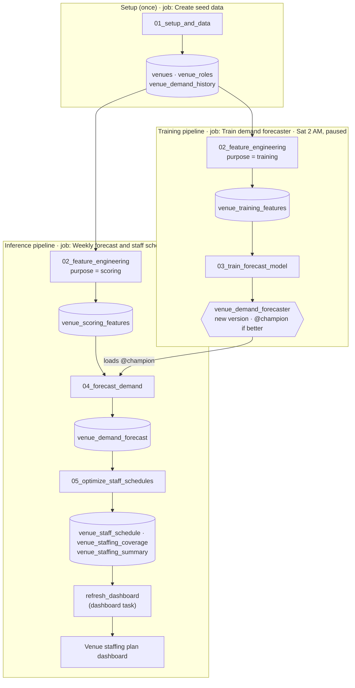

# WFM training on Databricks

Hands-on training material: a small, end-to-end workforce management (WFM) pipeline on Databricks, built on synthetic
data. It forecasts hourly guest demand for each venue, then builds optimized staff schedules for each venue.

| Notebook / file | What it does |
|---|---|
| `00_README` | Start here: the step-by-step lab guide |
| `01_setup_and_data` | Creates the schema, the `exports` volume and the source data: 20 venues, staffing roles, two years of hourly guest counts |
| `02_feature_engineering` | Builds model features from the raw data, for training or for scoring the coming days |
| `03_train_forecast_model` | Trains an XGBoost demand model, tracks it in MLflow, registers it in Unity Catalog, and promotes `@champion` if it beats the current champion |
| `04_forecast_demand` | Inference: loads `@champion` and forecasts every venue and open hour in the scoring features |
| `05_optimize_staff_schedules` | Builds staff schedules with OR-Tools CP-SAT, solving venues in parallel with Spark |
| `wfm_utils.py` | Shared helpers: synthetic data generator and calendar features |
| `databricks.yml`, `resources/` | Declarative Automation Bundle (DAB): the pipelines, the seed-data job and the dashboard |
| `dashboards/venue_staffing_plan.lvdash.json` | The **Venue staffing plan** AI/BI dashboard |

## The flow



| Pipeline (job) | Task | Notebook | Writes |
|---|---|---|---|
| Create seed data | `create_seed_data` | `01_setup_and_data` | `venues`, `venue_roles`, `venue_demand_history` |
| **Training:** Train demand forecaster | 1. `feature_engineering` | `02_feature_engineering` (`purpose = training`) | `venue_training_features` |
| | 2. `train_and_register` | `03_train_forecast_model` | model version, `@champion` / `@challenger` |
| **Inference:** Weekly forecast and staff schedules | 1. `feature_engineering` | `02_feature_engineering` (`purpose = scoring`) | `venue_scoring_features` |
| | 2. `forecast_demand` | `04_forecast_demand` | `venue_demand_forecast` |
| | 3. `optimize_schedules` | `05_optimize_staff_schedules` | `venue_staff_schedule`, `venue_staffing_coverage`, `venue_staffing_summary` |
| | 4. `refresh_dashboard` | (dashboard task) | refreshed **Venue staffing plan** |

- **Training and inference never call each other.** Training publishes a model by moving the `@champion` alias, and
  inference always loads whatever `@champion` points to.
- Both pipelines use the same `02_feature_engineering` notebook, so features are computed the same way for both.
- **Schedules:** inference runs every Sunday at 1:00 AM ET and plans the coming Monday to Sunday. Training has a weekly
  Saturday schedule that starts paused.

Both pipelines are defined in `resources/wfm_pipelines.yml`. Every notebook parameter is a job parameter there, with
defaults from the bundle variables in `databricks.yml` (`catalog`, `schema`, `model_name`, `node_type_id`,
`spark_version`, `warehouse_id`, `notification_email`).

## Get started

1. This repo is private. Ask the owner to add your GitHub account as a collaborator, and accept the invite.
2. In Databricks, link GitHub once: user icon → **Settings → Linked accounts** → **GitHub**.
3. Go to **Workspace → your user folder → Create → Git folder**, paste this repo's URL, and create the Git folder.
4. Open `00_README` and follow the steps.

You need a Unity Catalog catalog where you can create a schema, and permission to create personal compute.
The notebooks run on Databricks Runtime ML (LTS).

## Deploy the bundle

From the workspace: open `databricks.yml` in the Git folder, set `catalog` under your target, click the **Deployments**
icon (rocket), choose a target, and click **Deploy**. This needs serverless compute enabled in the workspace.

Or with the Databricks CLI:

```bash
databricks bundle validate -t dev --var="catalog=<your_catalog>"
databricks bundle deploy   -t dev --var="catalog=<your_catalog>"
databricks bundle run seed_data -t dev --var="catalog=<your_catalog>"
databricks bundle run training  -t dev --var="catalog=<your_catalog>"
databricks bundle run inference -t dev --var="catalog=<your_catalog>"
```

`dev` prefixes the job names with your name and pauses all schedules. `prod` runs the weekly inference schedule.
If your workspace has no "Serverless Starter Warehouse", pass `--var="warehouse_id=<id>"` for the dashboard.

## What it creates

- **Schema** `<catalog>.wfm_training`
  - tables `venues`, `venue_roles`, `venue_demand_history`, `venue_training_features`, `venue_scoring_features`,
    `venue_demand_forecast`, `venue_staff_schedule`, `venue_staffing_coverage`, `venue_staffing_summary`
  - volume `exports`
  - model `venue_demand_forecaster`
- **MLflow experiment** `/Users/<you>/wfm_training_demand_forecast`
- **Jobs and dashboard** from the bundle

All data is synthetic.
